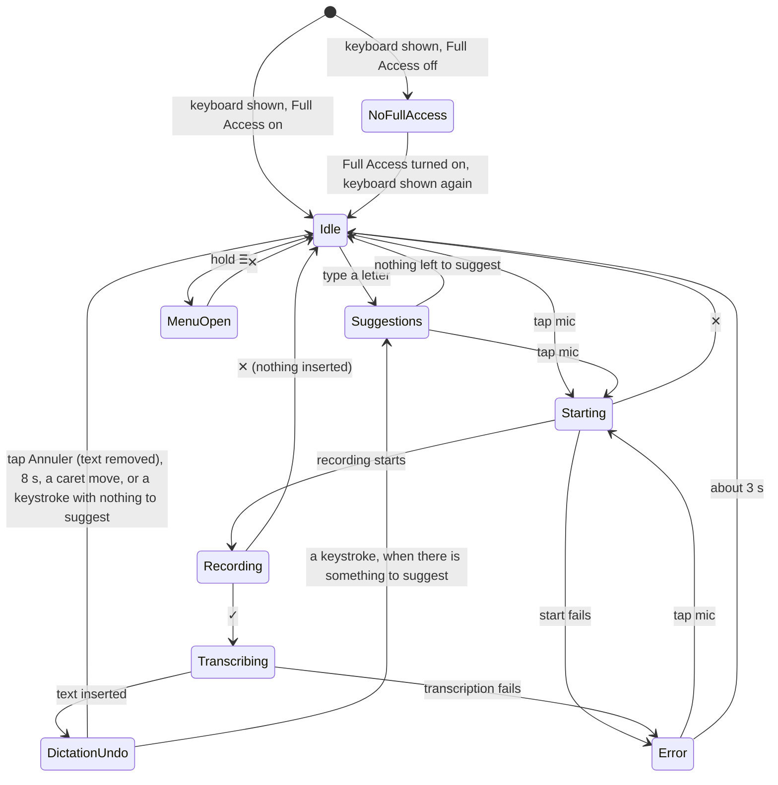

# Dictus screen map

One stable ID per screen, `<surface>.<area>[.]`, with `app` (DictusApp), `kbd` (the keyboard extension, drawn inside any host app), `share`, `widget` and `sys` (iOS system screens Dictus depends on). Like feature IDs, screen IDs name what the user sees, not the SwiftUI view, so another platform can map its own screens onto them.

Captures are in [`docs/agents/screens/`](../../../../docs/agents/screens/), one `<screen-id>.png` each, iPhone 17, iOS 26.5, French device, status bar fixed at 09:41, resized to 874 px high. They were taken with this skill's scripts on 2026-10-20 (the dictation states with a real model and a real recording); re-take one with `evidence.sh <name>` and `sips -Z 874` (see `../SKILL.md`, Evidence). Recipes abbreviate `drive.sh`; `…` repeats the previous row's command.

| Screen ID | Screen | How to reach it | Features | Capture |
| --- | --- | --- | --- | --- |
| `app.onboarding.welcome` | Onboarding: « Parlez. Dictus écrit. » intro carousel | launch.sh (fresh install) | onboarding | [oui](../../../../docs/agents/screens/app.onboarding.welcome.png) |
| `app.onboarding.language` | Onboarding: « Votre langue » + layout | tap-id onboarding.primary on the intro | onboarding, keyboard.languages | [oui](../../../../docs/agents/screens/app.onboarding.language.png) |
| `app.onboarding.keyboard-setup` | Onboarding: « Activez le clavier » | set-default dictus.onboardingStep -string keyboardSetup | onboarding | [oui](../../../../docs/agents/screens/app.onboarding.keyboard-setup.png) |
| `app.onboarding.apple-intelligence` | Onboarding: « Apple Intelligence se prépare » | … -string appleIntelligence | onboarding, polish | [oui](../../../../docs/agents/screens/app.onboarding.apple-intelligence.png) |
| `app.onboarding.smart-modes-scene` | Onboarding scene: « Un appui long, un Smart Mode » | … -string smartModesScene | onboarding, smart-modes | [oui](../../../../docs/agents/screens/app.onboarding.smart-modes-scene.png) |
| `app.onboarding.smart-mode-pick` | Onboarding: « Vos 3 Smart Modes » picker | … -string smartModePick | onboarding, smart-modes | [oui](../../../../docs/agents/screens/app.onboarding.smart-mode-pick.png) |
| `app.onboarding.voice-notes-scene` | Onboarding scene: voice memos | … -string voiceNotesScene | onboarding, voice-notes | [oui](../../../../docs/agents/screens/app.onboarding.voice-notes-scene.png) |
| `app.onboarding.vocabulary-scene` | Onboarding scene: « Vos mots, bien écrits » | … -string vocabularyScene | onboarding, vocabulary | [oui](../../../../docs/agents/screens/app.onboarding.vocabulary-scene.png) |
| `app.onboarding.history-scene` | Onboarding scene: « Tout se retrouve » | … -string historyScene | onboarding, history | [oui](../../../../docs/agents/screens/app.onboarding.history-scene.png) |
| `app.onboarding.model-preparation` | Onboarding: model download and preparation | … -string modelPreparation (starts a download) | onboarding, models.transcription | non |
| `app.onboarding.microphone` | Onboarding: « Dictus a besoin du micro » | … -string microphonePrompt | onboarding | [oui](../../../../docs/agents/screens/app.onboarding.microphone.png) |
| `app.onboarding.first-dictation` | Onboarding: « Essayez maintenant » practice field, keyboard open, globe animation in the drawn iPhone above Apple's keyboard (#845) | … -string firstDictation | onboarding, dictation.keyboard | [oui](../../../../docs/agents/screens/app.onboarding.first-dictation.png) |
| `app.onboarding.stop-standby` | Onboarding: « Pour arrêter Dictus » | … -string stopStandby | onboarding, live-activity | [oui](../../../../docs/agents/screens/app.onboarding.stop-standby.png) |
| `app.onboarding.completion` | Onboarding: « C'est prêt » | … -string completion | onboarding | [oui](../../../../docs/agents/screens/app.onboarding.completion.png) |
| `app.whats-new` | What's new (existing user behind 2.0.0) | set-default dictus.hasCompletedOnboarding -bool YES, then dictus.lastVersionSeen -string 1.8.0 | onboarding | [oui](../../../../docs/agents/screens/app.whats-new.png) |
| `app.home` | Tab Accueil (no model: « Télécharger un modèle pour commencer »; with a model, a round mic above the history hint) | launch.sh --skip-onboarding | dictation.in-app, history | [oui](../../../../docs/agents/screens/app.home.png) |
| `app.recording` | Full-screen in-app recording | Accueil → round mic `home.newDictation` (needs a model; records the Mac's mic) | dictation.in-app | non |
| `app.history` | History sheet (empty state) | Pro on, Accueil → tap-label Historique | history | [oui](../../../../docs/agents/screens/app.history.png) |
| `app.history.detail` | Transcription detail | History → a row (needs a transcription) | history, vocabulary | non |
| `app.models` | Tab Modèles | tab Modèles | models.transcription | [oui](../../../../docs/agents/screens/app.models.png) |
| `app.models.languages` | Supported languages sheet | Modèles → the Small (quantifié) card's ⓘ (see models.transcription) | models.transcription | [oui](../../../../docs/agents/screens/app.models.languages.png) |
| `app.models.loading` | Full-screen model preparation: « On prépare votre modèle », download then « Optimisation pour cet iPhone » | Modèles → tap-label « Small (quantifié) » (a real download, see models.transcription) | models.transcription | [oui](../../../../docs/agents/screens/app.models.loading.png) |
| `app.settings` | Tab Réglages | tab Réglages | keyboard.languages, polish, typing.*, live-activity, diagnostics.logs | [oui](../../../../docs/agents/screens/app.settings.png) |
| `app.settings.sounds` | Réglages → Sons | Réglages, scroll, tap-label Sons | feedback.sounds-haptics | [oui](../../../../docs/agents/screens/app.settings.sounds.png) |
| `app.settings.diagnostic` | Réglages → Diagnostic | Réglages, scroll to À propos, tap-label Diagnostic | diagnostics.logs | [oui](../../../../docs/agents/screens/app.settings.diagnostic.png) |
| `app.settings.debug-logs` | Réglages → Debug Logs | … tap-label « Debug Logs » | diagnostics.logs | [oui](../../../../docs/agents/screens/app.settings.debug-logs.png) |
| `app.settings.licences` | Réglages → Licences | … tap-label Licences | diagnostics.logs | [oui](../../../../docs/agents/screens/app.settings.licences.png) |
| `app.settings.polish-debug` | Polish debug screen | Réglages → tap « Version » five times | polish | non |
| `app.pro.hub` | Dictus Pro hub | Pro on, Réglages → tap-label « Dictus Pro, Pro actif » | pro.subscription | [oui](../../../../docs/agents/screens/app.pro.hub.png) |
| `app.pro.smart-modes` | Pro → Mode intelligent (pinned modes) | hub → « Mode intelligent, … » | smart-modes | [oui](../../../../docs/agents/screens/app.pro.smart-modes.png) |
| `app.pro.history` | Pro → Historique (switch, demo) | hub → « Recherche dans l’historique, … » | history | [oui](../../../../docs/agents/screens/app.pro.history.png) |
| `app.pro.vocabulary` | Pro → Vocabulaire (switch, « Comment ça marche » card that names « Analyser mes transcriptions », terms with « Remplace : … » or « En attente d’erreurs à corriger », « Ajouter un terme », « Analyser mes transcriptions ») | hub → « Vocabulaire, … » | vocabulary | [oui](../../../../docs/agents/screens/app.pro.vocabulary.png) |
| `app.pro.vocabulary.term-editor` | « Nouveau terme » sheet | Vocabulaire → « Ajouter un terme » | vocabulary | non |
| `app.pro.vocabulary.suggestions` | « Suggestions depuis l’historique » sheet, « Vos orthographes, écrites autrement » first (Accepter / Ignorer, ids `vocabulary.pair.<rank>.accept` / `.ignore`) | Vocabulaire → « Analyser mes transcriptions » (seeded History, see vocabulary) | vocabulary | [oui](../../../../docs/agents/screens/app.pro.vocabulary.suggestions.png) |
| `app.pro.vocabulary.pair-review` | « Avant l’ajout » sheet: the change in one sentence, the term and the new variant as editable fields, the term's variants, Annuler / Ajouter | suggestions → tap-id vocabulary.pair.1.accept | vocabulary | [oui](../../../../docs/agents/screens/app.pro.vocabulary.pair-review.png) |
| `app.pro.voice-notes` | Pro → Messages vocaux (language, after transcription) | hub → « Messages vocaux, … » | voice-notes | [oui](../../../../docs/agents/screens/app.pro.voice-notes.png) |
| `app.paywall` | Paywall (plans and prices) | Accueil → « Débloquez Dictus Pro, … » (no trial running); prices need simslim's `store` category, see pro.subscription Gotchas | pro.subscription | [oui](../../../../docs/agents/screens/app.paywall.png) |
| `app.pro.trial-announcement` | Reverse-trial announcement sheet | « C'est prêt » → « Commencer » on a fresh install (`kind=newUser`); or Réglages → Developer → « Forget the trial » + « Forget What's new », relaunch, end of What's new (`kind=existingUser`) | pro.subscription | [oui](../../../../docs/agents/screens/app.pro.trial-announcement.png) |
| `app.voice-note.result` | Voice-note result cards | share an audio file to Dictus (no messaging app in the simulator) | voice-notes | non |
| `kbd.keys` | Dictus keyboard, letters (AZERTY), toolbar with ☰ and mic | full-access, select-keyboard | dictation.keyboard, typing.autocorrect | [oui](../../../../docs/agents/screens/kbd.keys.png) |
| `kbd.no-full-access` | Keyboard bar « Accès complet requis », mic greyed | select-keyboard before full-access | dictation.keyboard | [oui](../../../../docs/agents/screens/kbd.no-full-access.png) |
| `kbd.dictation-error` | Keyboard after a mic tap with no model (failure message) | kbd mic with no model installed (proof run) | dictation.keyboard | [oui](../../../../docs/agents/screens/kbd.dictation-error.png) |
| `kbd.recording` | Keyboard recording overlay: ✕ / ✓, waveform, timer, « En écoute... » | kbd mic with a model (records the Mac's mic, see dictation.keyboard) | dictation.keyboard | [oui](../../../../docs/agents/screens/kbd.recording.png) |
| `kbd.transcribing` | Keyboard overlay after ✓: no buttons, waveform, « Transcription... » | ✓ on `kbd.recording`, screenshot within the transcription (~10 s on this Mac) | dictation.keyboard | [oui](../../../../docs/agents/screens/kbd.transcribing.png) |
| `kbd.dictation-undo` | Keys back, inserted text in the field, « ↶ Annuler » in the bar's left slot | right after a dictation is inserted (8 s window) | dictation.keyboard | [oui](../../../../docs/agents/screens/kbd.dictation-undo.png) |
| `kbd.numbers` | Keyboard 123 page: digits, punctuation, `#+=`, `ABC` | kbd abc on the letters page (the same bottom-left key reads 123) | keyboard.languages | [oui](../../../../docs/agents/screens/kbd.numbers.png) |
| `kbd.symbols` | Keyboard `#+=` page: brackets, maths, currencies, `123`, `ABC` | on `kbd.numbers`, tap `#+=` at (+30, +187) pt from `inputView` | keyboard.languages | [oui](../../../../docs/agents/screens/kbd.symbols.png) |
| `kbd.panel` | Keyboard panel: languages and layouts | kbd menu-hold | keyboard.languages | [oui](../../../../docs/agents/screens/kbd.panel.png) |
| `kbd.emoji` | Emoji picker | kbd emoji | keyboard.emoji | [oui](../../../../docs/agents/screens/kbd.emoji.png) |
| `kbd.voice-note-reader` | Voice-note reader (empty: « Aucune note vocale récente ») | kbd menu | voice-notes | [oui](../../../../docs/agents/screens/kbd.voice-note-reader.png) |
| `kbd.smart-mode-fan` | Smart Mode fan (greyed: no Apple Intelligence) | Pro on, kbd mic-fan, screenshot during the drag | smart-modes | [oui](../../../../docs/agents/screens/kbd.smart-mode-fan.png) |
| `kbd.suggestions` | Suggestion bar above the keys (undo chip after a correction) | Rappels, `type bonjoru`, `space` (see typing.autocorrect) | typing.autocorrect | [oui](../../../../docs/agents/screens/kbd.suggestions.png) |
| `sys.settings.full-access` | iOS Réglages → Claviers → Dictus, « Autoriser l'accès complet » on | full-access | dictation.keyboard | [oui](../../../../docs/agents/screens/sys.settings.full-access.png) |
| `share.voice-note` | Share extension sheet | Partager → Dictus from a messaging app | voice-notes | non |
| `widget.live-activity` | Live Activity in the Dynamic Island | leave Dictus with standby on (not reproduced) | live-activity | non |

45 of 53 screens captured. Each « non » is explained in the Gotchas of the feature it belongs to: a model download, a recording of the Mac's microphone, Apple Intelligence, StoreKit or a messaging app.

## The keyboard's top bar: states and transitions

The strip above the keys is the keyboard's one control surface: suggestions, the mic, the menu, dictation feedback and dictation undo all take turns in the same 52 pt band, which never changes height. This section describes what the user sees in it and what moves it from one state to the next, so another platform can build the same bar ([dictus-android#139](https://github.com/getdictus/dictus-android/issues/139)). It describes behaviour, not implementation.

Layout of the bar when nothing is happening: menu ☰ on the left, a centre slot, the blue mic pill on the right. The centre slot holds one thing at a time; when several apply, the higher one in this order wins: error, dictation undo, suggestions, then quiet hints (the armed Smart Mode's name, a "long press" tip). Error, dictation undo and suggestions need the width, so they also take the ☰'s place. During a dictation the bar and the keys give way to one overlay that fills the whole keyboard.

| State | What the user sees | Entered by | Left by | Capture |
| --- | --- | --- | --- | --- |
| **No Full Access** | Keyboard icon and « Accès complet requis » centred, mic greyed and inert, no ☰. The keys still type. | Showing the keyboard while Full Access is off. | Turning on Accès complet in Réglages, then showing the keyboard again → **Idle**. | `kbd.no-full-access` |
| **Idle** (menu + mic) | ☰ left, empty centre (or a quiet hint), blue mic pill right. | Showing the keyboard with Full Access; or the end of any state below. | Typing → **Suggestions**. Tap mic → **Starting**. Tap ☰ → voice note reader (Pro). Hold ☰ → **Menu open**. Hold mic → Smart Mode fan (Pro). | `kbd.keys` |
| **Suggestions** | Up to three slots in place of ☰ and centre: completions or corrections while typing, next-word predictions after a space, a ↶ chip with the original word after an autocorrection (`typing.undo-correction`, not the dictation undo). Mic still on the right. | Typing. | Nothing left to suggest (e.g. the field emptied) → **Idle**. Tap mic → **Starting**. | `kbd.suggestions` |
| **Menu open** | ✕ left, Dictus Pro entry (non-subscribers) and ⚙ right, no mic; languages and layouts fill the key area. | Holding ☰. | ✕ → **Idle**. ⚙ opens the app. | `kbd.panel` |
| **Starting** | Overlay over the whole keyboard: ✕ only, « Démarrage... ». On a cold start the app comes forward on « Dictée en cours » (« Préparation du micro… » while its audio session recovers, #853) and the user swipes back to the host app. | Tap mic in **Idle** or **Suggestions** (or in **Error**). | The app starts recording → **Recording**. ✕ → **Idle**. A failure → **Error**. | none (lasts about a second warm) |
| **Recording** | Overlay: ✕ left, green ✓ right, live waveform, timer, « En écoute... ». | Recording has started. | ✓ → **Transcribing**. ✕ → **Idle**, nothing inserted. | `kbd.recording` |
| **Transcribing** | Overlay: no buttons, waveform breathing, « Transcription... » (« Traitement... » while a Smart Mode or polish runs). Cannot be cancelled. | ✓ on **Recording**. | Text inserted at the cursor → **Dictation undo**. A failure (no words, no model…) → **Error**. | `kbd.transcribing` |
| **Dictation undo** | Keys back, the dictated text in the field, « ↶ Annuler » in place of ☰ (left), mic right. | A dictation was just inserted. | Tap « Annuler » → the inserted text is removed → **Idle**. Eight seconds pass, or the user types or moves the cursor → **Idle** (or **Suggestions**). | `kbd.dictation-undo` |
| **Error** | A grey, two-line explanation centred (never red), mic right, no ☰. | A dictation failed. | About three seconds → **Idle**. Tap mic → **Starting**. | `kbd.dictation-error` |

Not in the diagram, because they leave the bar rather than change it: a tap on ☰ opens the voice note reader over the whole keyboard (`kbd.voice-note-reader`), and a hold on the mic opens the Smart Mode fan (`kbd.smart-mode-fan`), whose release either starts a dictation (**Starting**) or aborts back to **Idle**. The 123 and `#+=` pages (`kbd.numbers`, `kbd.symbols`) change the keys only; the bar above them behaves exactly as on the letters page.
